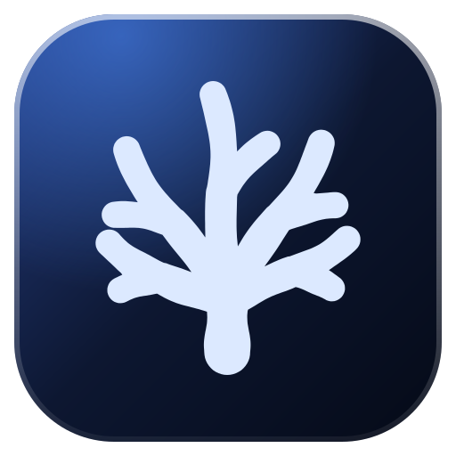
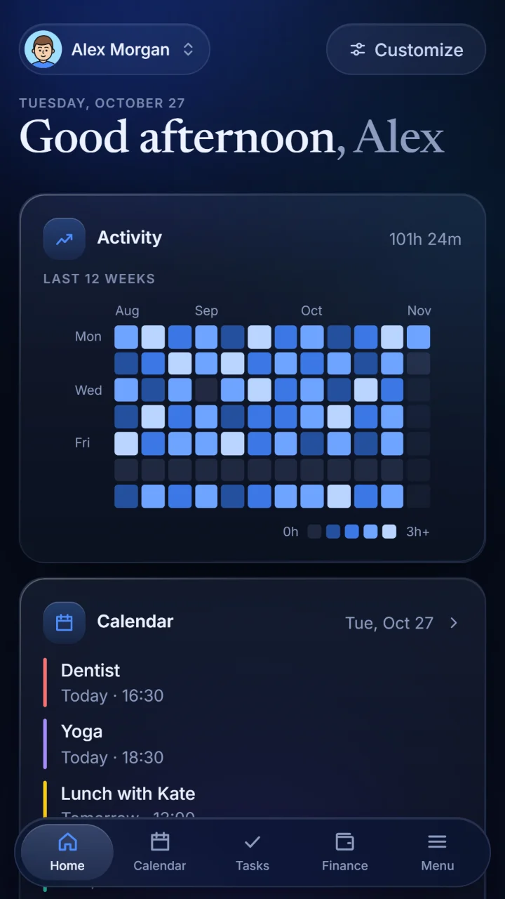
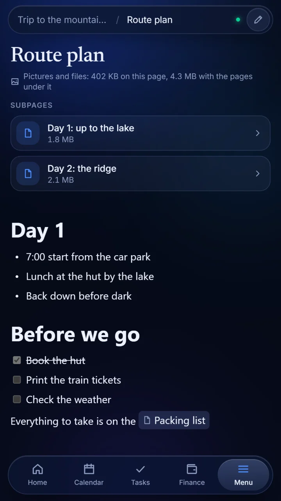
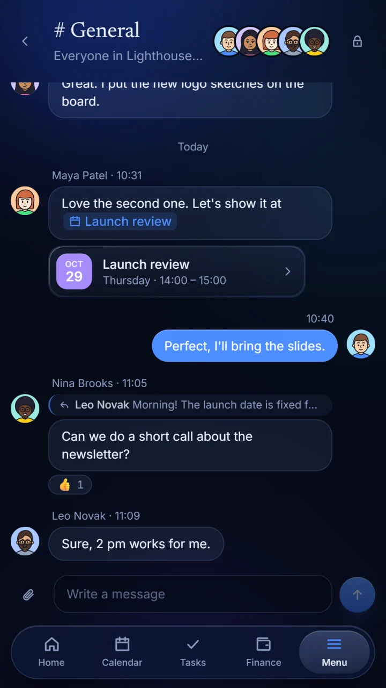
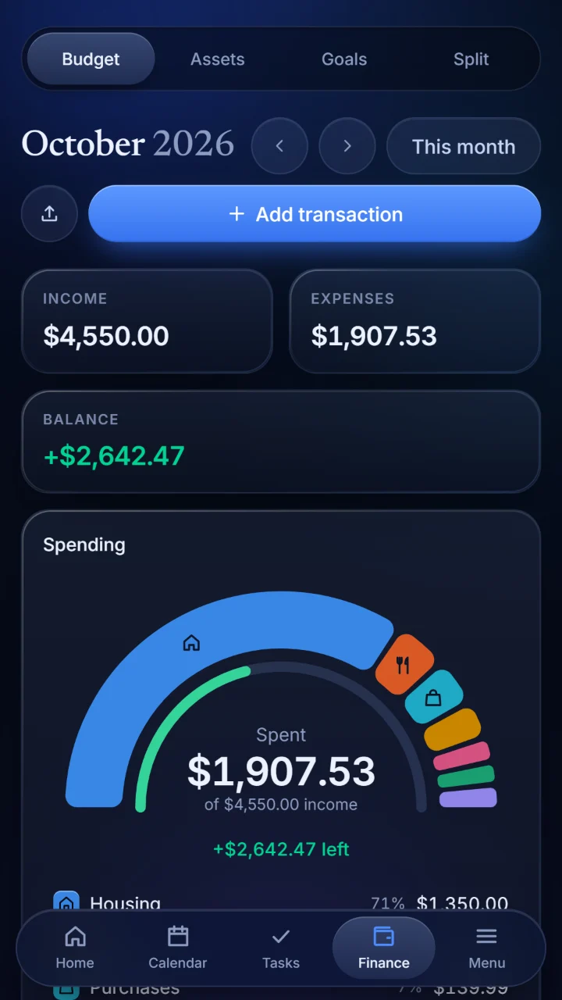

# Notereef

**Your notes, calendar, tasks and money in one calm place, shared with the people you work with.**

[**Website**](https://notereef.com) · [**Download for Windows**](https://github.com/patbargg/notereef-releases/releases/latest) · [**Open in the browser**](https://notereef.com/app/) · [**Privacy**](https://notereef.com/privacy.html)

 

&nbsp;
&nbsp;
&nbsp;

 

## Get Notereef

| | Where | Notes |
|---|---|---|
| 🪟 **Windows** | [Latest release](https://github.com/patbargg/notereef-releases/releases/latest) | Download `Notereef_…_x64-setup.exe` and run it. The app updates itself from then on. |
| 🌐 **Browser** | [notereef.com/app](https://notereef.com/app/) | Nothing to install. Works on any computer. |
| 🤖 **Android** | Google Play (closed testing) | When a release carries a `.apk`, it can also be installed by hand. |

One account works everywhere, and what you change on one device shows up on the others right away.

## What's inside

<table>
<tr>
<td width="50%" valign="top">

### 📝 Pages
A block editor where several people write on one page at once and see each other's cursors. Link pages with `@` or `[[Page]]`, see how they connect in the **graph**, and bring a whole folder of Markdown notes in or out as it was.

</td>
<td width="50%" valign="top">

### 📅 Calendar
Events in colors of your own that repeat every day, week, month or year. Read a month straight from a **screenshot** of another calendar. On the phone, reminders arrive on time.

</td>
</tr>
<tr>
<td valign="top">

### ✅ Tasks
A board of to do, in progress and done, with deadlines and times. Finished tasks clear themselves away. In a team, a task says who started it and who finished it.

</td>
<td valign="top">

### 💰 Finance
Budget, savings goals and shared expenses with friends. Import a bank's **screenshots** in seconds. Follow stocks and ETFs with buys, sells and the history of every position.

</td>
</tr>
<tr>
<td valign="top">

### 🧮 Spreadsheets &amp; 🎨 Whiteboards
Spreadsheets with a hundred formulas, and cells that can run a few lines of JavaScript. Whiteboards to draw, sketch and leave notes on together.

</td>
<td valign="top">

### 🗂️ Drive
Files and folders in your own space, shared folder by folder. Upload a whole folder, or download one as a ZIP.

</td>
</tr>
<tr>
<td valign="top">

### 🏢 Organizations
A shared place for a team, with its own calendar, tasks, money and pages. It has a **chat** with channels, private messages, replies, reactions and files, and departments with permissions part by part.

</td>
<td valign="top">

### 🪸 ReefAI
An assistant that reads and changes your calendar, tasks, pages, spreadsheets and money when you ask. On Windows it runs **on your own computer**, so nothing leaves it. It can also work in a folder, search the web, and form a team of models. You can bring your own key for Gemini, Claude or ChatGPT instead.

</td>
</tr>
</table>

### 🎙️ On Windows, also
- **ReefAI Cowork:** say *“Hey Reef”* and ask it to open a program, play something or change the volume. It also clicks and types for you inside programs.
- **An assistant on the screen:** a small orb you talk to directly. Mark part of the screen and it sees what you mean.
- **Apps:** run a program of your own and show its page right inside Notereef.

## Languages

🇬🇧 English · 🇵🇱 Polski · 🇩🇪 Deutsch · 🇪🇸 Español, with your currency and the first day of the week of your choice.

## Privacy

Notereef has no ads, no analytics and no tracking, and your data is never sold. Your account's data lives in the EU (Ireland). What is kept, where, and why is explained in the [privacy policy](https://notereef.com/privacy.html). You can delete your account in the app's settings, or [from a browser](https://notereef.com/delete-account.html).

 

 
Made with care in Poland · <a href="https://notereef.com">notereef.com</a>

